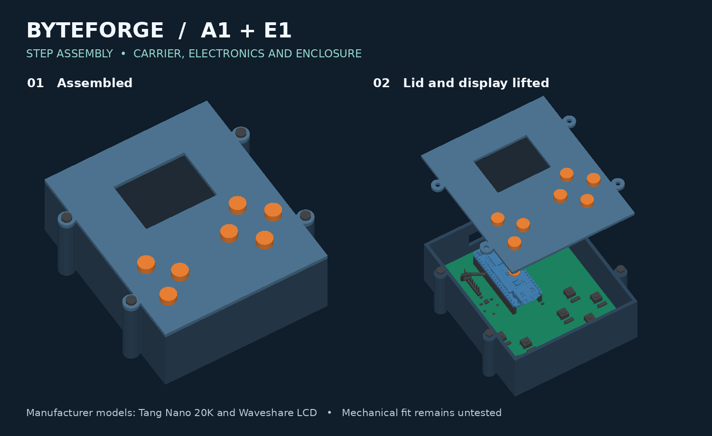
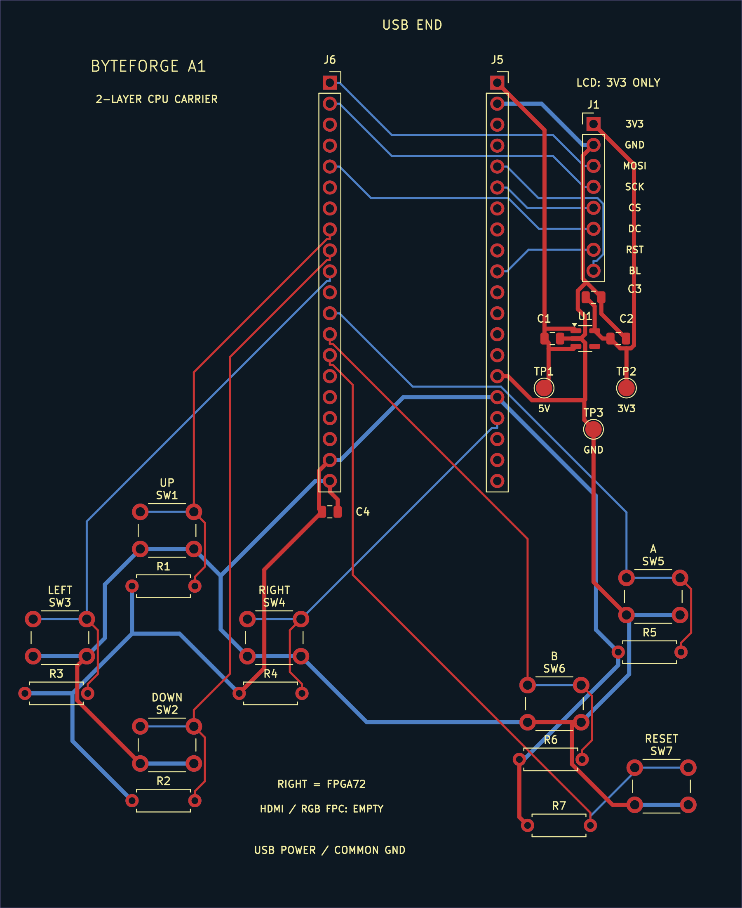
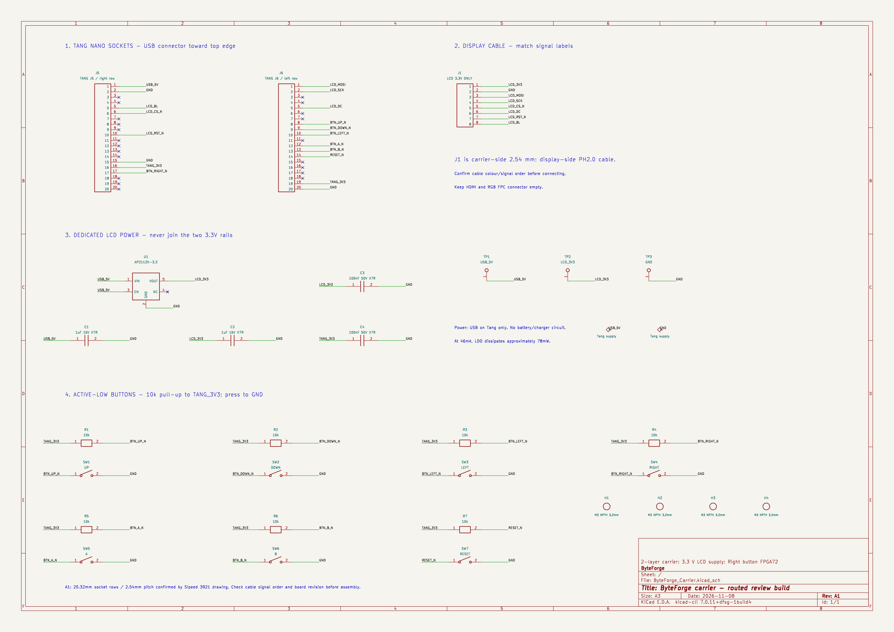
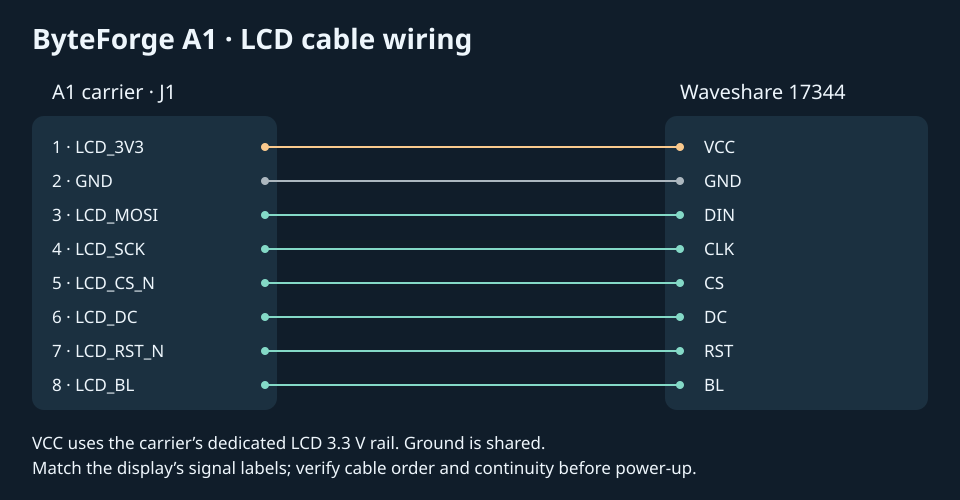

# ByteForge

ByteForge is a handheld FPGA computer built around a custom 8-bit CPU, a small assembler, an SPI display and physical buttons. The goal is to understand how a computer works from instruction decoding through to the PCB and controls, and to run programs on the resulting device.

The current design pairs the **A1 carrier** with the **E1 enclosure**. Earlier revisions remain in the repo as a record of the design progression. The current files are gathered in [Design_Review](Design_Review/).

## E1 assembly

[Download the full STEP and editable CadQuery source](Design_Review/Assembly/ByteForge_A1_E1_STEP_Review.zip). After extraction, open `hardware/step_review/ByteForge_A1_E1_Assembly.step` for the full assembly. The archive also includes manufacturer models, CAD build scripts and enclosure STLs.

## A1 PCB and wiring

[Editable KiCad project and EasyEDA backup](Design_Review/PCB/) · [Gerbers and drill files](Design_Review/PCB/A1_Gerbers_and_Drills_REVIEW.zip) · [FPGA and assembler source](fpga/) · [Architecture documentation](ByteForge_Architecture_v13.pdf)

## Verification and build status

The A1 carrier passed KiCad ERC and PCB DRC, and the fabrication audit matched the 90 × 110 mm outline and all 94 drill hits to the PCB design. The FPGA implementation passed the saved simulation regressions and met the 27 MHz internal timing target. See [verification files](Design_Review/Verification/) and [FPGA results](fpga/docs/ENTRY13_PIN72_RESULTS.md).

This is a design review package. No boards have been ordered and physical fit and hardware operation remain untested. Check the vendor manufacturing preview and actual delivered quote before ordering.

## Bill of materials

See [BOM.csv](BOM.csv) for part numbers, supplier links and notes. Quantities cover one handheld plus a five-board lot and selected spares. Prices are planning allowances in Singapore dollars.

| Item | Needed per unit | Planned buy | Allowance (SGD) |
|---|---:|---:|---:|
| [FPGA](https://shopee.sg/Tang-Nano-20K-FPGA-Development-Board-RISCV-Linux-for-Retro-Game-Player-i.183691527.50404625405) | 1 | 1 | 70 |
| [Display](https://www.waveshare.com/product/2inch-lcd-module.htm) | 1 | 1 | 18 |
| [Carrier PCBs](https://jlcpcb.com/quote) | 1 | 5 | 25 |
| [Socket headers](https://www.digikey.sg/en/products?keywords=PPTC201LFBN-RC) | 2 | 2 | 5 |
| [LCD header](https://www.digikey.sg/en/products?keywords=PRPC008SAAN-RC) | 1 | 1 | 2 |
| [LCD regulator](https://www.digikey.sg/en/products?keywords=AP2112K-3.3TRG1) | 1 | 2 | 3 |
| [Input/output capacitors](https://www.digikey.sg/en/products?keywords=GRM21BR71C105KA01L) | 2 | 5 | 2 |
| [Decoupling capacitors](https://www.digikey.sg/en/products?keywords=GRM21BR71H104KA01L) | 2 | 5 | 2 |
| [Pull-up resistors](https://www.digikey.sg/en/products?keywords=CF14JT10K0) | 7 | 10 | 2 |
| [Tact switches](https://www.digikey.sg/en/products?keywords=B3F-1000) | 7 | 8 | 5 |
| [USB cable](https://www.digikey.sg/en/products?keywords=USB%20A%20to%20USB%20C%20data%20cable%201m) | 1 | 1 | 8 |
| [Wiring](https://www.digikey.sg/en/products?keywords=2.54mm%20jumper%20wire%20female) | 1 set | 1 set | 6 |
| [Enclosure fasteners](https://www.digikey.sg/en/products?keywords=M3%20screws%20plastic%20thread%20forming) | 1 set | 1 set | 5 |
| [Printing](https://printing.hackclub.com/) | 1 set | 1 set | 15 |
| [Shipping and taxes](https://jlcpcb.com/quote) | 1 allowance | 1 allowance | 35 |
| Contingency | 1 allowance | 1 allowance | 20 |
| **Provisional total** | | | **223** |
